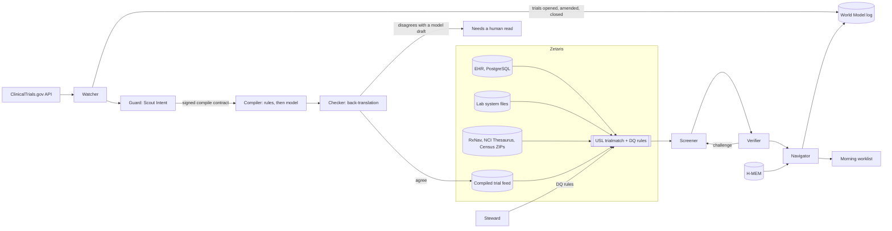

# Nightlist

Every night, Nightlist re-screens a community cancer clinic's lung cancer patients against every recruiting lung cancer trial near the clinic, and hands the research coordinator a worklist in the morning.

The model reads the trials. It never reads the patients. Each eligibility criterion is compiled from public trial text into a typed check, a second model checks the compilation, and Zetaris runs the checks as SQL over patient data that stays in the clinic's systems.

Track: Solving Fragmented Intelligence (Open Agent Hackathon 2026).

## Try it in 60 seconds

No accounts, keys or Docker needed. Node 20 or newer.

```bash
git clone https://github.com/kinnuworks/nightlist.git && cd nightlist
npm ci && npm run build -w web
npm run demo
npm start
```

Open http://localhost:8787 (set `PORT` to use another port) and start with the patient the worklist puts first. Or skip the UI and run one overnight screen from the command line:

```bash
curl -s -X POST http://localhost:8787/run -H "Content-Type: application/json" -d @input_examples/example_1.json
```

It reads last night's run and returns the headline, the agents involved, one patient's matches with the criteria a person still has to read, and the path of the trace for that run. Set `"rerun": true` in `options` to screen the whole clinic again first (a few seconds; the morning view then shows changes since that new run). Three sample inputs and the outputs they produced are in [input_examples/](input_examples/) and [output_examples/](output_examples/). With Docker: `docker build -t nightlist . && docker run --rm -p 8787:8787 nightlist`.

## Where to check each requirement

| Requirement | Proof |
|---|---|
| Zetaris is the data layer | [sql/](sql/) (six sources, USL `trialmatch`, six DQ rules), applied by `npm run zetaris:setup`, run log in [docs/zetaris-run.md](docs/zetaris-run.md) |
| A Meterless engine works in a feature, with a passing test | World Model, H-MEM and Scout Intent in [engines/](engines/); `npm run engines` runs the official Meterless suites |
| Nightshift is the AI provider | [server/src/nightshift.ts](server/src/nightshift.ts); a live run's trace with the model per request in [docs/nightshift-run.md](docs/nightshift-run.md) |
| NVIDIA Nemotron | 2,896 model requests in two live runs, all served by NVIDIA Nemotron and each logged with the model that served it: [docs/nightshift-run.md](docs/nightshift-run.md), traces in [logs/](logs/) |
| Runs from a clean clone, no accounts | `npm run setup`, `npm run demo`, `npm start` (sample mode), or the [Dockerfile](Dockerfile); `POST /run` with [three sample inputs and outputs](input_examples/) |
| Evaluation | [docs/EVALUATION.md](docs/EVALUATION.md); `npm run eval` |
| Demo video and slide deck | Links in the submission form |

## The problem

About 7% of adult cancer patients in the US enroll in a treatment trial, and the rate at community hospitals is closer to 4% ([Unger et al., JCO 2024](https://www.healthday.com/healthpro-news/cancer/patient-enrollment-in-cancer-treatment-trials-about-7-percent)). Poor accrual is the most common non-scientific reason cancer trials close early. Screening one patient against one trial by hand takes 45 to 56 minutes ([Penberthy et al., J Oncol Pract 2012](https://pmc.ncbi.nlm.nih.gov/articles/PMC3500483/)), and a community clinic sees hundreds of lung cancer patients against hundreds of open trials, with new trials opening and patients' results changing every week.

The data a coordinator needs sits in systems that do not share identifiers: the EHR, the lab system (with its own MRN format), free-text medication orders, molecular reports, and ClinicalTrials.gov. In advanced NSCLC about half of potentially eligible patients are lost to gaps in biomarker testing ([Sadik et al., JCO Precis Oncol 2022](https://pmc.ncbi.nlm.nih.gov/articles/PMC9666118/)), so "we do not know yet" is as important an answer as "yes" or "no".

## What it does

- Pulls the recruiting NSCLC trials with a US site from ClinicalTrials.gov (471 today; the demo clinic is in Montgomery, Alabama, and screens the 106 within 250 miles).
- Splits each trial's eligibility text into atomic criteria and compiles each one into a check in a small typed language (age, histology, stage, ECOG, biomarkers, PD-L1, prior therapy, lines of therapy, labs, conditions, brain metastases, measurable disease). Criteria it cannot express go to "needs a human read"; consent, contraception and washouts go to "confirmed at screening".
- Runs every check for every patient inside the data layer and returns met, not met, or unknown per criterion. Unknown names the data item that would resolve it.
- Re-reads the source rows behind every open match and challenges it when the evidence does not hold up, for example when a tissue panel and a plasma panel disagree about the same gene.
- Keeps an append-only log of trials, patient facts and verdicts, so the morning view shows what changed overnight: trials that opened, new lab results, new and lost matches.
- Remembers coordinator decisions ("will not travel more than 100 miles") and applies them on later nights.
- Lists patients who are one data item away from several trials, for example "a comprehensive NGS panel would settle the open checks on 18 trials for Gloria Haynes", ordered so treatment-changing tests come first and flagging items that need tissue.

Nightlist never says a patient is eligible. Every patient and trial pair lands in one of four groups:

| Group | Meaning |
|---|---|
| No blockers found | Every disease-defining criterion was checked from records and none blocks the patient |
| Key criterion needs a human read | Nothing checked blocks the patient, but a criterion about the disease, its stage, a gene or prior therapy could not be checked from records (or the Verifier found conflicting evidence) |
| Open items | Nothing blocks; some checks are unknown because data is missing, and the data item to obtain is named |
| Blocked | At least one criterion is not met, with the source row that decided it |

With the model path off (rules only), the demo night puts 111 of 25,440 pairs in "no blockers found" and 12,499 in "key criterion needs a human read". That is deliberate: the system only says "no blockers" when the criteria that define the trial's population were actually checked.

## Run it

Requirements: Node 20 or newer. No accounts, keys or Docker needed for sample mode.

```bash
npm run setup
```

```bash
npm run demo
```

```bash
npm start
```

Open http://localhost:8787. `npm run demo` builds two overnight runs a day apart (night 2: two trials open, Gloria Haynes's NGS result arrives, a coordinator records a travel limit), so the "what changed overnight" panel has real events. `npm run night` runs one more night on the current state.

Sample mode (`SAMPLE_MODE=true`, the default) runs the same semantic-layer SQL that Zetaris runs in live mode, in an embedded DuckDB over the same source files. It runs the real agent logic on cached trial data; nothing is replayed from saved outputs. When Nightshift has been run, its model compilations and checks are cached with the serving model recorded, and sample mode reuses them; until then, sample mode uses the rule compiler only and the Run page says so.

Live mode: copy `.env.example` to `.env`, set the Zetaris and Nightshift values, and follow [docs/SETUP.md](docs/SETUP.md).

### Without the UI

`POST /run` re-runs the overnight screen and returns structured JSON: the headline, what changed overnight, the top of the worklist, the agents and their roles, the trace id and log file, and, when the input names a patient, that patient's matches and open items. Send `"options": { "rerun": false }` to read the latest run instead. Errors come back as `{"status": "error", "error": {"type", "message", "recoverable"}}`. See [input_examples/](input_examples/).

Every screen is also backed by a JSON route:

```bash
curl localhost:8787/api/worklist
```

```bash
curl localhost:8787/api/match/P10001/NCT07100080
```

The second returns every criterion of one trial for one patient, with the compiled rule, the SQL that decided it, and the source rows behind it. Other routes: `/api/patient/:id`, `/api/trial/:nct`, `/api/trace`, `/api/usl`, `/api/summary`, `/api/status`, `POST /api/memory`, `POST /api/run`.

## How it works



| Agent | Job | Can block or send back |
|---|---|---|
| Watcher | Pulls the trial snapshot, records what opened, changed or closed in the World Model | |
| Guard | Runs Scout Intent on untrusted trial text before any model sees it; the compiler proceeds only on a verified signed contract for that exact criterion, and compiles the sanitized text | Blocks injected instructions |
| Compiler | Deterministic rules first, then the model through Nightshift for the rest; validates every output against the schema, retries once | Sends uncompilable criteria to review |
| Checker | A second model call restates the compiled rule without seeing how it was made, then judges it against the sentence | Flags a disputed rule for the coordinator; a disputed model draft stays in review |
| Steward | Runs the semantic layer's data-quality rules | Rows that fail are excluded and reported |
| Screener | One SQL pass per trial evaluates every check for every patient | |
| Verifier | Re-reads the evidence rows behind every open match: rows must exist, and results for the same gene must not conflict across reports | Sends the match back for a human read (12 challenges on the demo data) |
| Navigator | Applies remembered coordinator decisions, records verdicts, writes the worklist | Sets matches aside per recorded preferences |

Every action is written to `logs/<run>.jsonl` and stdout with the agent, the target, the model that served the request and the duration. The Run page in the UI shows the same trace.

The model only ever sees public trial text. Patient rows are touched only by SQL that code generated from a validated predicate, so the design holds even when the model runs in the cloud.

## Sponsor technology

**Zetaris (data layer).** Six sources with no shared identifiers are registered in Zetaris and queried in place: the clinic EHR (PostgreSQL datasource), the lab system's result and molecular files (its MRN is `MRN0001234` where the EHR has `0001234`), ClinicalTrials.gov, RxNav and the NCI Thesaurus as live REST tables, resolved terminology tables, and the nightly compiled trial feed. A Unified Semantic Layer, `trialmatch`, joins them into ten tables (patient, diagnosis, metastasis, biomarker, lab, therapy, condition, trial, site, criterion). Its activation queries are where the fragmentation is resolved: lab MRNs to EHR patients, free-text medication orders to RxNav ingredients and ATC classes, free-text histology to NCI Thesaurus concepts, molecular report wording to alterations. Six data-quality rules run every night; on the demo data they catch six lab results filed under a mistyped MRN and nine lab values exported without a unit, which are excluded from screening and listed on the Run page. All the SQL is generated from one schema file into [sql/](sql/) and applied with `npm run zetaris:setup`. Our notes for the Zetaris team are in [docs/zetaris/](docs/zetaris/).

**Meterless (engines and model runtime).** Three Meterless engines, each implemented by us from the published spec and tested with the official suite:

| Engine | What it does here | Official test |
|---|---|---|
| World Model | Canonical event log of trials, sites, criteria, patient facts and match verdicts; powers "what changed overnight" with provenance | conformance 8/8 ([engines/world-model](engines/world-model/CONFORMANCE.txt)) |
| H-MEM | Remembers coordinator preferences, decisions and corrections across nights, with a ledger, conflict resolution and sleep cycle | conformance 13/13 ([engines/hmem](engines/hmem/CONFORMANCE.txt)) |
| Scout Intent | Guards the compiler against instructions hidden in trial text; signs a contract that allows only `compile_criterion` | eval harness, all 7 gates ([engines/scout-intent](engines/scout-intent/EVAL.txt)) |

Nightshift is the app's AI provider: every model call goes through its OpenAI-compatible runtime with the `meterless-app` header, using routing modes (`meterless/deep` to compile, `meterless/fast` to check), and the trace records the model that served each request. In the live runs Nightshift had only an NVIDIA key, so every request went to Nemotron.

**NVIDIA.** Nemotron does the model work. In the two live runs Nightshift served 2,889 of 2,896 requests with `nemotron-3.5-bolt-e4b` (about 4.5 seconds per compile) and 7 with `nemotron-3-ultra-550b-a55b`. Nightshift races the models on each route and keeps the first good answer, so the small fast model won almost every time. The Checker restated 1,337 compiled rules and disagreed with 774. Its catches include a rule that accepted only stage III when the trial also took stages IB to IIIB, and a platelet threshold compiled as "100 x ULN" instead of 100,000 per microliter.

We then scored both model roles on the blind final sample, and the results changed the design. Of the model's own compilations that passed the Checker and would have screened patients, 1 of 9 matched the gold label, so a model compilation is now a draft: it shows on the criterion as "model draft" and screens nobody until a person confirms it. On the rule compiler's output the Checker disagreed with 11 rules that were correct and 2 that overreached, so for rules a disagreement is a flag the coordinator sees beside the rule ("Checker disagrees: ..."), and the rule still screens. With both changes the compiler keeps the precision reported below: 83.8% on the blind final test, 87.0% for the current code on the same (no longer blind) sample.

**Cursor.** Not used. The Official Rules make it optional, and we built with a different AI coding assistant (see AI and model usage).

## AI and model usage

Models (through Meterless Nightshift, the app's only AI provider):
- NVIDIA Nemotron, through the `meterless/deep` route, compiles eligibility criteria the rules cannot express into the typed check language. Output is validated against the schema and rejected if a range has no bound; one retry, then human review. A compilation that passes is a draft a person confirms before it screens anyone.
- NVIDIA Nemotron, through the `meterless/fast` route, restates each compiled check in plain words and judges it against the sentence. A disagreement keeps a model draft in review and puts a visible flag on a rule.
- The trace records the model Nightshift reports for every request. Until a live Nightshift run is cached, sample mode uses the rule compiler only and says so.

Sponsor technology:
- Zetaris: data layer for six sources, the `trialmatch` USL and six DQ rules (see Sponsor technology above).
- Meterless engines: World Model (overnight changes), H-MEM (coordinator decisions carried across nights), Scout Intent (guard on trial text), each with the official test suite.
- Meterless Nightshift: primary AI provider, OpenAI-compatible runtime with `meterless-app` and `meterless-scope` headers.
- NVIDIA: Nemotron models in the compile and check lanes.

Agent frameworks: none. The agents are plain TypeScript modules coordinated by `server/src/night.ts`.

Development tools: built with an AI coding assistant. AI-assisted coding was used for scaffolding, debugging and documentation. All generated code was reviewed and tested.

Sample mode: `SAMPLE_MODE=true` (the default) runs the same semantic-layer SQL in an embedded DuckDB over the same source files, with no calls to Zetaris or Nightshift.

## Evaluation

The compiler is measured by behaviour. A random sample of real criteria from the screened trials was labeled blind (the labeler never saw compiler output). For every labeled criterion, the compiled check and the gold label are both run against all 240 patients; a criterion counts as correct only when every patient gets the same verdict. Rules were tuned on a development sample and a second sample. A third sample was drawn and labeled after those rule changes and scored once, before anything else changed: on it the rule compiler gave the gold verdict for every patient on 83.8% of the criteria it compiled, and compiled 84.7% of the criteria that can be compiled. That is the number we quote. Rules fixed after that test score 87.0% on the same sample, but that sample is no longer blind. Results and every error: [docs/EVALUATION.md](docs/EVALUATION.md).

Run it yourself:

```bash
npm run eval
```

This re-scores the current code on the final sample and writes the report to `data/runtime/eval/`.

## Tests

```bash
npm test
```

Server: criterion splitting, rule compilation including traps (KRAS G12D vs G12C, eGFR vs EGFR), three-valued logic, the model path against a stand-in Nightshift runtime, and a full overnight run checked against what the demo patients' records say. Engines: the official Meterless suites plus our own unit tests.

## Data

- Trials: live ClinicalTrials.gov API v2 snapshot (`data/sources/ctgov_nsclc_us.json.gz`; refresh with `npm run trials -w server`).
- Patients: 240 synthetic patients generated by `server/scripts/generate-clinic.ts`, with distributions taken from published NSCLC figures (histology, stage, driver mutation rates, incomplete biomarker testing). Eight hand-written patients carry the demo stories. No real patient data is used anywhere.
- Terminology: RxNav (NLM) and NCI Thesaurus (EVS) lookups made live by `server/scripts/resolve-terminology.ts`; US Census ZCTA centroids for distances.

## Limitations

- The rule compiler covers the criteria that recur in lung cancer trials. The rest depend on the model path; with Nightshift offline they are shown as needing a human read rather than guessed.
- Time windows, assay requirements and some exceptions are not checked. Every compiled criterion lists what it ignores, and the UI shows it.
- Patients are synthetic. Real EHR data would need mapping from FHIR or a clinic's export into the same source tables.
- Nightlist ranks and explains; a coordinator and the trial team decide.

## Repository

| Path | Contents |
|---|---|
| `server/src` | Agents, compiler, evaluator, data layer, API |
| `server/scripts` | Data generation, terminology resolution, Zetaris SQL generator and runner, evaluation, demo |
| `engines/` | World Model, H-MEM and Scout Intent engines with the official Meterless test suites |
| `web/` | The worklist UI (also builds as a static replay) |
| `sql/` | Generated Zetaris Lightning SQL |
| `data/` | Source files, evaluation sets |
| `input_examples/`, `output_examples/` | Three `POST /run` requests and the responses they produced |
| `infra/` | EHR database container and the Zetaris mount override |
| `docs/` | Setup, evaluation, Zetaris notes, sponsor technology |

## Third-party code and licences

- Hono and @hono/node-server (MIT): HTTP API
- @duckdb/node-api (MIT): embedded engine for sample mode
- zod (MIT): schema validation for compiled checks
- React, React DOM and Vite (MIT): the UI
- tsx (MIT) and TypeScript (Apache-2.0): runtime and type checking
- yaml (ISC): Scout Intent eval harness
- Meterless conformance and eval suites (Apache-2.0), copied unchanged into `engines/*/conformance` and `engines/scout-intent/evals`; see the NOTICE files there

## Pre-existing work

None. The repository was created during the build window. Open-source libraries are listed in the package files. The Meterless conformance and eval suites under `engines/*/conformance` and `engines/scout-intent/evals` are copied from the Meterless repository under Apache-2.0, as their NOTICE files state.
